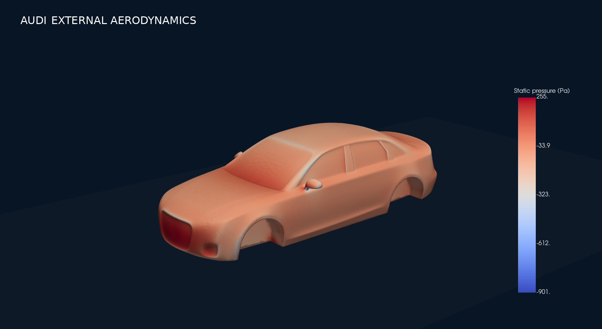
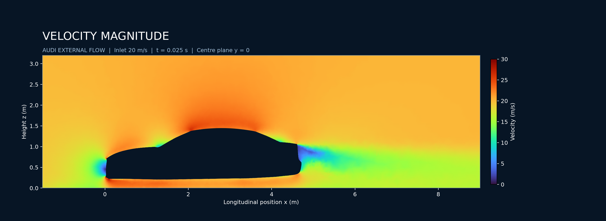
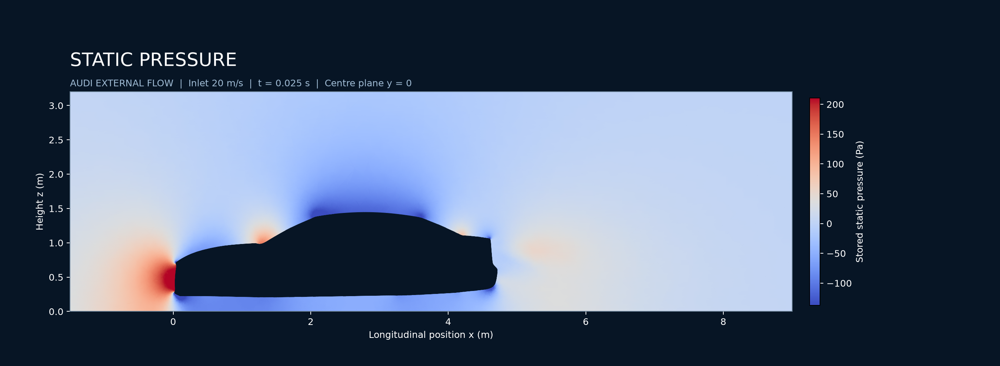
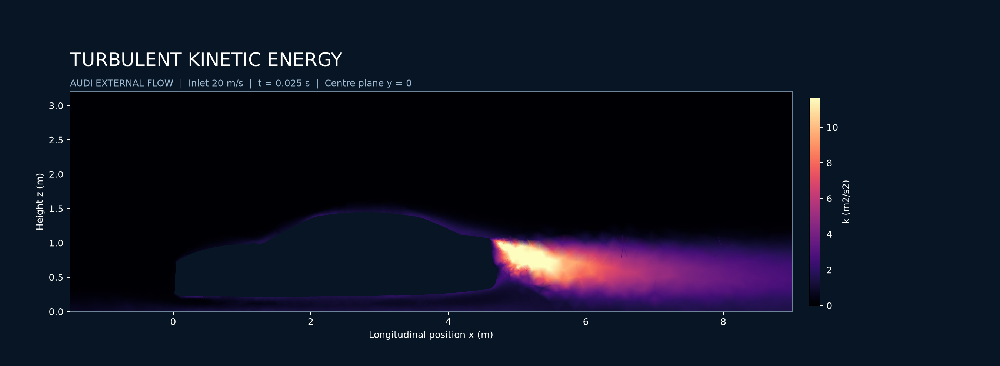
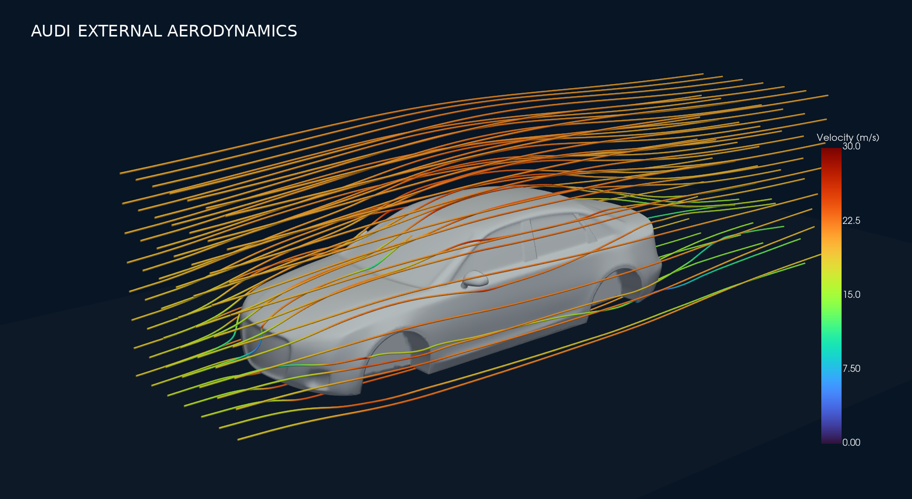

# Audi External Flow CFD

**Vehicle aerodynamics · ANSYS Fluent**

Explore the vehicle geometry, computational mesh, saved simulation and flow visualizations.

[View result images](result/) · [Simulation folder — mesh, case & data](simulation/)

## Project files

| Item | File / location | Purpose |
| :--- | :--- | :--- |
| Geometry | [audi-geo.igs](geometry/audi-geo.igs) | CAD model |
| Mesh | [car.msh](https://github.com/rahulsharma98962066-cell/audi-external-flow/releases/download/v1.0-cfd-files/car.msh) | Computational grid |
| Case | [audi_simplec_750iter.cas.h5](https://github.com/rahulsharma98962066-cell/audi-external-flow/releases/download/v1.0-cfd-files/audi_simplec_750iter.cas.h5) | Fluent mesh and setup |
| Data | [audi_simplec_750iter.dat.h5](https://github.com/rahulsharma98962066-cell/audi-external-flow/releases/download/v1.0-cfd-files/audi_simplec_750iter.dat.h5) | Matching saved solution |
| Simulation folder | [simulation/](simulation/) | Mesh, case and data download guide |
| Results | [result/](result/) | Images, plots and contours only |

The mesh and case/data files are provided as GitHub Release assets because they exceed the 25 MB browser-upload limit.

## Flow visualization gallery

| Velocity contour | Pressure contour |
| :---: | :---: |
|  |  |

| Turbulence contour | Velocity streamlines |
| :---: | :---: |
|  |  |

## Open in Fluent

1. Download the **case and data together** from [Simulation files](https://github.com/rahulsharma98962066-cell/audi-external-flow/releases/tag/v1.0-cfd-files).
2. Read `audi_simplec_750iter.cas.h5` first, then `audi_simplec_750iter.dat.h5`.
3. Use `car.msh` when starting a fresh setup, or `audi-geo.igs` to work on the CAD geometry.

## Result interpretation

The images show saved CFD visualizations. Their exact relationship to the downloadable snapshot has not been independently audited. A filename or contour alone does not establish convergence, mesh independence or experimental validation. Quantitative drag and lift require force reports and consistent reference values.

---
*Geometry → Mesh → Setup → Saved solution → Flow visualization*
